# freeQRent

**Beautiful, animated QR codes that always scan. Free forever, MIT licensed.**

freeQRent is a QR code generator you can build on. One small Rust core makes styled and animated SVG QR codes (colors, gradients, shapes, logos, pictures, motion), checks that each one still scans. Available as a library in Rust, JavaScript, Python, Go, Dart and Flutter, or the command line.

<table>
<tr>
<td align="center" valign="top" width="33%">

<details>
<summary>How it's made</summary>
<div align="left">

<code>freeqrent 'Hi Mom!' --shape liquid:0.85 --finder squircle/circle --bg '#fff2f6' --fg 'linear-gradient(135deg, oklch(36% .17 355), oklch(29% .15 300))' --token 'finder.eye=oklch(34% .18 15)' --logo docs/showcase/logos/heart.svg --logo-shape circle --logo-frame ring --logo-intro stamp --intro ripple --intro-ms 1400 --idle breathe --label 'Hi Mom!' --trigger every:5000 -o hi-mom.svg</code>

</div>
</details>
</td>
<td align="center" valign="top" width="33%">

<details>
<summary>How it's made</summary>
<div align="left">

<code>freeqrent 'Secret $4 Fee Not Included' --shape dots:0.86 --finder rounded:1.5/circle --bg '#f3fbf4' --fg 'linear-gradient(160deg, oklch(33% .1 160), oklch(28% .08 220))' --token 'finder.eye=oklch(34% .09 85)' --logo docs/showcase/logos/coin.svg --logo-shape circle --logo-frame orbit --logo-intro spin --intro sweep --intro-ms 1300 --idle shimmer --idle logo-spin --label 'Secret $4 Fee Not Included' --trigger every:5000 -o secret-fee.svg</code>

</div>
</details>
</td>
<td align="center" valign="top" width="33%">

<details>
<summary>How it's made</summary>
<div align="left">

<code>freeqrent 'Built with Claude because my programming skills got RUSTy (get it?)' --shape rounded:0.45 --finder squircle/squircle --frame circle:0.5 --frame-ring dashed --bg '#fff6ee' --fg 'radial-gradient(oklch(36% .13 40), oklch(26% .08 30))' --token 'finder.eye=oklch(35% .14 45)' --token 'filler=oklch(36% .13 40 / .3)' --logo docs/showcase/logos/gear.svg --logo-scale 0.24 --logo-shape circle --logo-frame beads --intro assemble --intro-ms 1600 --idle finder-pulse --idle logo-turn --label 'Built with Claude because my programming skills got RUSTy (get it?)' --trigger every:5000 -o rusty.svg</code>

</div>
</details>
</td>
</tr>
<tr>
<td align="center" valign="top" width="33%">

<details>
<summary>How it's made</summary>
<div align="left">

<code>freeqrent 'You found the secret level. There is no secret level.' --shape square:0.12 --finder square/square --timing dashed --bg '#0b1410' --fg 'linear-gradient(90deg, #7dffa8, #6fe3ff)' --token 'finder.eye=#c6ff7d' --allow-inverted --intro raster --intro-ms 1500 --idle shimmer --label 'You found the secret level. There is no secret level.' --trigger every:5000 -o secret-level.svg</code>

</div>
</details>
</td>
<td align="center" valign="top" width="33%">

<details>
<summary>How it's made</summary>
<div align="left">

<code>freeqrent 'Achievement unlocked: pointed phone at square' --shape bars-v:0.5 --finder rounded:1/rounded:0.8 --bg '#fff8ef' --fg 'linear-gradient(135deg, oklch(37% .16 30), oklch(33% .17 330), oklch(30% .15 285))' --intro iris --intro-ms 1400 --stagger polar --idle finder-pulse --label 'Achievement unlocked: pointed phone at square' --trigger every:5000 -o achievement.svg</code>

</div>
</details>
</td>
<td align="center" valign="top" width="33%">

<details>
<summary>How it's made</summary>
<div align="left">

<code>freeqrent 'This QR code is legally a hug' --shape dots:0.82 --finder rounded:1.5/circle --frame circle:0.5 --frame-ring solid --bg '#f1f6ff' --fg 'linear-gradient(135deg, oklch(34% .14 265), oklch(31% .13 200))' --token 'filler=oklch(34% .12 240 / .3)' --token 'finder.eye=oklch(36% .17 300)' --intro settle --intro-ms 1500 --stagger radial --idle breathe --label 'This QR code is legally a hug' --trigger every:5000 -o hug.svg</code>

</div>
</details>
</td>
</tr>
<tr>
<td align="center" valign="top" width="33%">

<details>
<summary>How it's made</summary>
<div align="left">

<code>freeqrent 'Dress code: black tie. Species: penguin.' --art docs/showcase/pictures/penguin.jpg --ink color --tracking-grid sparse --intro develop --intro-ms 1800 --label 'Dress code: black tie. Species: penguin.' --trigger every:5000 -o art-penguin.svg</code>

</div>
</details>
</td>
<td align="center" valign="top" width="33%">

<details>
<summary>How it's made</summary>
<div align="left">

<code>freeqrent 'Forged in Rust. Folded 1,000 times.' --art docs/showcase/pictures/samurai.jpg --ink mono --tracking-grid sparse --fg 'linear-gradient(160deg, oklch(28% .09 280), oklch(32% .14 20))' --intro sweep --intro-ms 1400 --label 'Forged in Rust. Folded 1,000 times.' --trigger every:5000 -o art-samurai.svg</code>

</div>
</details>
</td>
<td align="center" valign="top" width="33%">

<details>
<summary>How it's made</summary>
<div align="left">

<code>freeqrent 'Not all who wander are lost. Some are just scanning.' --art docs/showcase/pictures/windmill.jpg --ink color --tracking-grid sparse --intro ripple --intro-ms 1600 --idle shimmer --label 'Not all who wander are lost. Some are just scanning.' --trigger every:5000 -o art-windmill.svg</code>

</div>
</details>
</td>
</tr>
<tr>
<td align="center" valign="top" width="33%">

<details>
<summary>How it's made</summary>
<div align="left">

<code>freeqrent 'More is more. This QR code has never heard of restraint.' --allow-inverted --bg '#0d0d1a' --fg '#00f5d4' --token 'fg.2=#ffe600' --token 'fg.3=#ff77ff' --spread regions --token 'finder.eye=#ff77ff' --token 'filler=#ff3af2' --token 'frame=#ff6b35' --shape liquid:1 --finder leaf/circle --frame circle:0.7 --frame-ring dashed --effect glow:0.3:0.2 --intro ripple --intro-ms 1600 --stagger random --groups 10 --label 'More is more. This QR code has never heard of restraint.' --trigger every:5000 -o maximalism.svg</code>

</div>
</details>
</td>
<td align="center" valign="top" width="33%">

<details>
<summary>How it's made</summary>
<div align="left">

<code>freeqrent 'SCAN ME. Yes, you. No rounded corners were harmed.' --bg '#ffd93d' --fg '#000000' --shape square --timing dashed --border solid:1 --shadow 1.5 --caption 'SCAN ME' --caption-tracking 10 --intro assemble --intro-ms 1300 --stagger diagonal --label 'SCAN ME. Yes, you. No rounded corners were harmed.' --trigger every:5000 -o neo-brutalism.svg</code>

</div>
</details>
</td>
<td align="center" valign="top" width="33%">

<details>
<summary>How it's made</summary>
<div align="left">

<code>freeqrent '$ sudo scan --this-code. Permission granted.' --preset terminal --token 'finder.eye=#ffb000' --effect glow:0.25 --texture scanlines:0.2 --caption '$ sudo scan_' --caption-font mono --caption-size 1.5 --token 'caption=#ffb000' --intro raster --intro-ms 1500 --stagger linear --label '$ sudo scan --this-code. Permission granted.' --trigger every:5000 -o terminal.svg</code>

</div>
</details>
</td>
</tr>
</table>

Each was rendered by the `freeqrent` CLI and decoded with ZXing (and rqrr, where it reads the style) before it was written. Run the commands from the repository root; [`scripts/showcase.sh`](scripts/showcase.sh) renders all of them and checks each one with `--verify`; the art pieces are generated from jpeg images, in [`docs/showcase/pictures`](docs/showcase/pictures).

**Gallery:** [`gallery.html`](gallery.html) shows many presets, many style families and a card per design system (Bauhaus, neo-brutalism, terminal, vaporwave and more), each light and dark, with the command that makes it and decode information. GitHub shows HTML as source, so [open it rendered](https://raw.githack.com/cotw-fabier/freeqrent/main/gallery.html) instead. It's regenerated with `freeqrent "https://example.com/menu" --gallery gallery.html`.

## Why this exists

A QR code is a public standard, free for anyone to use. Making one shouldn't cost anything. Yet most QR generators online want an account, a subscription or a watermark the moment you want a color, a logo or a rounded corner. Some route your link through their own servers and switch the code off when you stop paying.

freeQRent is this web developer's way of giving back. It isn't a business. There's no paid tier, no account, no watermark and no "pro" feature held back. The goal is one complete, well-tested QR library that anyone can drop into a website, an app, a print shop or their own QR service, and ship for free.

- **Your code holds your data.** freeQRent writes your URL or text straight into the code. There's no redirect service, so a printed code keeps working forever.
- **Nothing phones home.** The library never touches the network: it can't track scans and doesn't need a server.
- **Use it for anything.** MIT means you can use it in commercial products, change it, or build your own generator on it. Credit is welcome but not required.

## What it does

- **Styles:** square, rounded, dot, bar and liquid modules. Styled finder eyes, alignment and timing patterns. Color tokens, gradients and multi-color data. Round frames, borders, hard shadows, captions, glow and emboss effects, and textures. Eight presets to start from.
- **Logos:** SVG, PNG, JPEG, GIF or WebP logos on plates with frames (ring, beads, stamp, brackets, orbit). The code grows until the logo fits inside its error-correction budget.
- **Brand palettes:** palettes that pass the contrast rules, pulled from a logo's pixels, a style sheet or a web page's HTML.
- **Pictures and art mode:** draw a photo into the code itself, with the code's spare data bits chosen to follow the picture.
- **Motion:** intros that play *into* the finished code, idle loops, and replays on load, on hover or every few seconds. It's all plain CSS, so renderers that ignore animation, and viewers who prefer reduced motion, see the finished static code.
- **Scannability first:** every style is checked against an error-correction and contrast budget, and the library refuses what it can't stand behind. The limits come from measurements with ZXing and rqrr and from real scans on iOS Camera and Google Lens. Every style option in this repository has a test that renders it and decodes it.
- **Embeddable:** the core has zero dependencies and no `unsafe`, runs on `no_std` and WebAssembly, and its output is deterministic: the same input gives byte-identical SVG in every language.


## Ways to use it

Every option is plain data, so a style is the same JSON-shaped document in every language, and every package passes the same conformance suite byte for byte ([`conformance/cases.json`](conformance/cases.json)). Pick the door that fits:

| You want to… | Use | Guide |
|---|---|---|
| Make codes from a terminal or a script | the `freeqrent` CLI | [Command line](#command-line) |
| Generate codes in a Rust program | the `freeqrent` crate | [The Rust library](#the-rust-library) |
| Generate codes in Node or the browser | `freeqrent` on npm (WebAssembly, TypeScript types) | [`bindings/js`](bindings/js/README.md) |
| Generate codes in Python | `freeqrent` for Python (abi3 wheels, CPython ≥ 3.9) | [`bindings/python`](bindings/python/README.md) |
| Generate codes in Go | `github.com/cotw-fabier/freeqrent/bindings/go` (cgo, or pure Go via WebAssembly) | [`bindings/go`](bindings/go/README.md) |
| Show codes in a Dart or Flutter app | `freeqrent` and `freeqrent_flutter`, with a native animated widget | [`bindings/dart`](bindings/dart/README.md) |
| Call it from Swift, Kotlin, C# or C | the C ABI, `include/freeqrent.h` | [`crates/freeqrent-ffi`](crates/freeqrent-ffi) |
| Browse every style and copy its command | the gallery | [open it rendered](https://raw.githack.com/cotw-fabier/freeqrent/main/gallery.html) |

The same style from the CLI, JavaScript, Python and Dart (the CLI also labels a URL with itself for screen readers; set `label` to match it byte for byte):

```sh
freeqrent "https://example.com" --preset ink --shape dots:0.9 --intro ripple -o code.svg
```

```js
import { render } from 'freeqrent';
const svg = render('https://example.com', { preset: 'ink', modules: { kind: 'dots', size: 0.9 }, intro: 'ripple' });
```

```python
import freeqrent as fq
svg = fq.render("https://example.com", fq.Style(preset="ink", modules=fq.Dots(size=0.9), intro="ripple"))
```

```dart
final svg = FreeQrent.render('https://example.com', style: const QrStyle(
  preset: QrPreset.ink,
  modules: QrModuleShape.dots(size: 0.9),
  intro: QrIntro.preset(preset: QrIntroName.ripple),
));
```

### Installing

**Version 1.1.0 is on [GitHub releases](https://github.com/cotw-fabier/freeqrent/releases/tag/v1.1.0). The packages aren't on crates.io, npm, PyPI or pub.dev yet;** publishing them all together is the next milestone (M9 in [`SPEC.md`](SPEC.md) §12). Until then:

```sh
# CLI
cargo install --git https://github.com/cotw-fabier/freeqrent freeqrent-cli

# Rust: in Cargo.toml
# freeqrent = { git = "https://github.com/cotw-fabier/freeqrent", tag = "v1.1.0" }

# npm
npm install https://github.com/cotw-fabier/freeqrent/releases/download/v1.1.0/freeqrent-1.1.0.tgz

# Python: the release has a macOS universal2 wheel and an sdist (the sdist builds with a Rust toolchain)
pip install https://github.com/cotw-fabier/freeqrent/releases/download/v1.1.0/freeqrent-1.1.0.tar.gz
```

Dart and Flutter use a path dependency on a checkout ([`bindings/dart`](bindings/dart/README.md)). Go's cgo build links prebuilt libraries that aren't committed yet: build them with `scripts/build-prebuilt.sh --go` ([`bindings/go`](bindings/go/README.md)). The release also carries the C ABI for Linux, macOS, Windows, iOS, Android and wasm32, with `SHA256SUMS`.

## The Rust library

### Basics

```rust
use freeqrent::{Ecc, ModuleShape, Palette, QrCode, Style};

let qr = QrCode::encode("https://example.com", Ecc::M)?;
let svg = Style::new()
    .modules(ModuleShape::Dots { size: 0.85 })
    .palette(Palette::from_tokens([("fg", "oklch(32% .08 265)")])?)
    .label("https://example.com")
    .render(&qr)?;
```

Or start from a preset, an ordinary style to change like any other: `classic`, `ink`, `candy`, `terminal`, `sunset`, `bubble`, `ribbon` or `leaf` (`Style::presets()` lists them).

```rust
use freeqrent::{Ecc, ModuleShape, QrCode, Style};

let qr = QrCode::encode("https://example.com", Ecc::M)?;
let svg = Style::preset("candy").unwrap()
    .modules(ModuleShape::Dots { size: 0.9 })
    .render(&qr)?;
```

### Logos

Encode *for* the style, and the code grows until the logo fits its error-correction budget. Logos are SVG (sanitized) or PNG, JPEG, GIF or WebP.

```rust
use freeqrent::{Ecc, Frame, FrameRing, Logo, LogoFrame, LogoShape, ModuleShape, QrCode, Style};

let mark = r##"<svg xmlns="http://www.w3.org/2000/svg" viewBox="0 0 10 10">
    <circle cx="5" cy="5" r="4" fill="#a3302a"/></svg>"##;
let style = Style::new()
    .modules(ModuleShape::Liquid { smoothness: 0.8 })
    .frame(Frame::Circle { filler_density: 0.5, ring: FrameRing::Solid })
    .logo(Logo::svg(mark)?.scale(0.22).shape(LogoShape::Circle).frame(LogoFrame::Ring));
let qr = QrCode::builder().ecc(Ecc::Q).encode_text_for("https://example.com", &style)?;
let svg = style.render(&qr)?;
```

### Palettes from a brand

The core derives a palette that passes the contrast rules from raw RGBA pixels, a style sheet or a page. It never fetches anything. The `freeqrent-image` crate decodes PNG and JPEG into the pixel buffer.

```rust
use freeqrent::{Palette, PaletteOpts, Rgba8Image, Style};

let (palette, report) = Palette::from_css(":root { --brand: #1d3b72; --paper: #f8f5ee; }")?;
// or: Palette::from_html(html)?, or from pixels:
// let image = freeqrent_image::decode(&std::fs::read("brand.png")?)?;
let image = Rgba8Image::filled(8, 8, [29, 59, 114, 255])?;
let (from_pixels, _) = Palette::from_image(&image, PaletteOpts::new())?;
let style = Style::new().palette(palette); // report.choices says where each token came from
```

### Pictures and motion

`Halftone::new(image)` draws a picture into any code's modules, choosing the code's spare data bits so its modules follow the picture. `Style::art(halftone)` is the large-image setup, with crisp tracking boxes. `Intro::new(Preset::Settle)` and seven other presets play the code in, once or, with `Trigger::Every(ms)`, again every few seconds. `Style::plan` exports the same motion as data, for players outside CSS.

```rust
use freeqrent::{Ecc, Intro, Preset, QrCode, Style};

let qr = QrCode::encode("https://example.com", Ecc::M)?;
let svg = Style::preset("ink").unwrap()
    .intro(Intro::new(Preset::Ripple).duration_ms(900))
    .render(&qr)?;
```

### Checking and verifying

`style.check(&qr)` returns a `ScanReport`. Its errors (contrast below the floor, a logo past the budget, no quiet zone) make `render` refuse, and its warnings name soft risks such as inverted colors or rounded finder rings. The `freeqrent-verify` crate rasterizes a render with resvg and decodes it with ZXing and rqrr, held to the bar the report implies. That is how every style option in this repository is tested.


### Features

| Feature | Default | Enables |
|---|---|---|
| `std` | yes | `std::error::Error` impls, `Style::render_io` |
| `animate` | yes | Intros, idle loops, palette transitions, `AnimationPlan` |
| `palette-extract` | yes | Palettes from pixels and CSS/HTML text |
| `halftone` | yes | Pictures in codes and art mode |
| `kanji` | no | Kanji mode (a ~27 KB JIS X 0208 table) |

`default-features = false` gives a `no_std` build. The minimum supported Rust version is 1.92.

## Command line

```sh
freeqrent "https://example.com" --preset ink --verify -o code.svg
freeqrent "https://example.com" --shape dots:0.8 --finder squircle/circle --logo logo.svg --intro ripple -o code.svg
freeqrent "https://example.com" --gallery gallery.html   # every style family, with the flags for each
```

The CLI covers the whole style surface; `freeqrent --help` lists every flag. That includes palettes from images, style sheets and pages (`curl -s URL | freeqrent … --palette-from-html -`), logos with their frames and motion, pictures and art mode, intros and idle loops, `--check` and `--verify`, and a device scan sheet (`--scan-sheet sheet.html`) for checking codes with real phones. [`bindings/SURFACE.md`](bindings/SURFACE.md) maps every flag onto the Style document the language packages take.

## How it's built

| Crate | What it is |
|---|---|
| `freeqrent` | The core: encoder, styles, SVG writer, animation, palettes. No dependencies, `no_std` + `alloc`, no `unsafe`. |
| `freeqrent-image` | PNG and JPEG decoding into the core's `Rgba8Image`. |
| `freeqrent-verify` | Rasterizes a render with resvg and decodes it with ZXing and rqrr to prove it scans. |
| `freeqrent-cli` | The `freeqrent` command-line tool. |
| `freeqrent-doc` | The boundary every binding shares: Style documents (JSON) in; SVG, reports, plans and palettes out, with structured errors. |
| `freeqrent-ffi` | The C ABI over `freeqrent-doc`, for Dart, Go and any other FFI host. |

The QR encoder is written from scratch (versions 1–40, every error-correction level, numeric, alphanumeric, byte, Kanji and ECI segments) and checked module for module against `qrcodegen`, `rqrr` and ISO 18004's worked examples. The JSON schema ([`schema/freeqrent.schema.json`](schema/freeqrent.schema.json)) and the conformance suite are generated from the library, so the bindings can't drift from it.

## Contributing

Issues, ideas and pull requests are welcome at [github.com/cotw-fabier/freeqrent](https://github.com/cotw-fabier/freeqrent/issues). A style you'd pay for somewhere else is a good feature request.

- [`SPEC.md`](SPEC.md) is the source of truth for what the library does and why.
- [`ROADMAP.md`](ROADMAP.md) holds ideas that aren't in the spec yet.
- [`docs/waves/LOG.md`](docs/waves/LOG.md) records what has landed, with the measurements behind each limit.
- [`AGENTS.md`](AGENTS.md) is the working agreement: the checks that run before anything merges, and the rules (zero core dependencies, deterministic output, and no style ships unless a test proves it scans).

## License

MIT, see [`LICENSE`](LICENSE). Free to use, change and ship, in personal and commercial work alike, now and forever.
